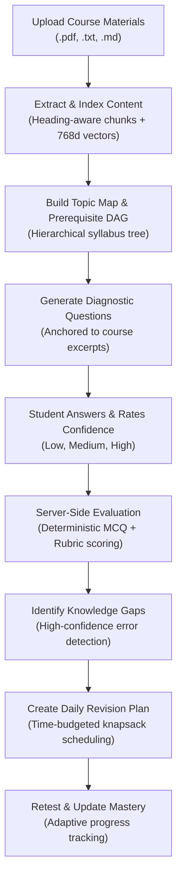
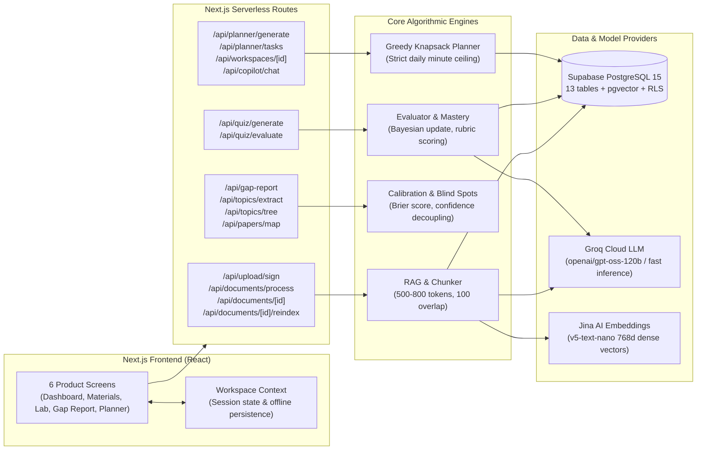

# GapLens AI

**See the gaps. Master what matters.**

[](https://gap-lens-ai-rho.vercel.app)
[](https://nextjs.org/)
[](https://www.typescriptlang.org/)
[-f55036)](https://groq.com/)
[-11998e)](https://jina.ai/)
[](https://supabase.com/)
[](https://vitest.dev/)

GapLens AI is an evidence-grounded study diagnostic platform that identifies what students actually know versus what they only think they know. By ingesting course materials, generating citation-backed diagnostic assessments, and detecting high-confidence blind spots, GapLens builds personalized daily revision plans constrained by the student's real study time.

---

## The Problem

Most students revise by rereading slides or re-watching lectures, spending equal time on topics they have already mastered and concepts they fundamentally misunderstand. When exam day arrives, their lowest scores often come from questions they were confident they understood—their unexamined blind spots.

General-purpose AI chatbots do not solve this problem. They passively wait for questions, generate plausible explanations that may hallucinate details outside the syllabus, and lack any systematic way to diagnose a student's weak areas or structure their revision time.

GapLens takes an active diagnostic approach: instead of waiting for students to ask questions, it tests their knowledge against their actual course materials, exposes misconceptions using source evidence, and schedules realistic revision blocks.

---

## How It Works



1. **Ingest Materials:** Upload syllabi, lecture notes, textbook chapters, or past exam papers.
2. **Map the Curriculum:** The system extracts text, preserves page and heading metadata, and organizes concepts into a hierarchical topic tree with prerequisite dependencies.
3. **Run Diagnostics:** Diagnostic questions (multiple-choice and short-answer) are generated directly from indexed course excerpts.
4. **Calibrate Confidence:** Before seeing any score, the student rates their confidence. High-confidence errors are flagged as critical blind spots.
5. **Review Evidence:** The Gap Report pairs each diagnosis with the exact textbook quotation that explains the underlying concept.
6. **Follow a Realistic Schedule:** A daily revision queue schedules high-priority tasks without exceeding the student's available study time.
7. **Retest and Adapt:** Taking a retest recalculates topic mastery and dynamically repacks the remaining study queue.

---

## Key Features

- **Course Material Ingestion:** Processes PDF, TXT, and Markdown files. Extracts structured text, preserves 1-based page numbers and headings, and alerts the user if a scanned document requires OCR.
- **Syllabus Knowledge Graph:** Visualizes topics and prerequisite relationships as an interactive directed graph, helping students see which foundational concepts block advanced topics.
- **Evidence-Grounded Diagnostics:** Creates questions with answer keys derived strictly from retrieved course chunks, ensuring tests reflect the syllabus rather than generic internet trivia.
- **Confidence Calibration & Blind-Spot Detection:** Decouples confidence capture from grading to identify dangerous misconceptions—questions answered incorrectly with high confidence.
- **Adaptive Knapsack Revision Planner:** Uses a greedy knapsack algorithm to allocate revision tasks into daily study blocks that never exceed the student's self-selected daily time budget.
- **Source-Locked Study Copilot:** An in-app drawer that answers student inquiries using retrieved course passages with citation badges, while refusing to speculate outside the course material.
- **Longitudinal Progress Tracking:** Persists mastery snapshots across retests and browser reloads, providing a transparent view of learning gains over time.

---

## Product Preview

| Screen | Core Purpose |
|---|---|
| **Dashboard** (`/dashboard`) | Displays overall preparation coverage, topic mastery breakdown, exam countdown, and today's revision queue. |
| **Course Materials** (`/materials`) | Lists uploaded documents, ingestion status steppers, syllabus units, and the interactive prerequisite knowledge graph. |
| **Diagnostic Lab** (`/diagnostic`) | Runs assessment challenges with decoupled confidence selectors, immediate citation feedback, and question generator preview. |
| **Hero Gap Report** (`/gap-report`) | The diagnostic centerpiece: displays the Mastery Matrix, Metacognitive Calibration Matrix, and expandable Evidence Ledger with source quotes. |
| **Revision Planner** (`/planner`) | Provides daily time-budget sliders (15m–24h / 1440 min), custom minute input, task completion checkboxes, and the source-locked Study Copilot drawer. |

> *UI Note:* Genuine UI screenshots will be added here following production release. You can explore all five interactive screens immediately using the local 1-Click Judge Demo.

---

## Try the Demo (1-Click Walkthrough)

GapLens includes a pre-seeded synthetic dataset based on an undergraduate **Operating Systems (CS-301)** course covering Virtual Memory, CPU Scheduling, Synchronization, File Systems, and Deadlock Avoidance.

You can run the entire platform locally without external API keys:

1. **Clone the repository:**
   ```bash
   git clone https://github.com/AnirudhChhabra54/GapLens-AI.git
   cd GapLens-AI
   ```

2. **Install dependencies and start the app:**
   ```bash
   pnpm install
   pnpm dev
   ```

3. **Open the application:**
   Navigate to [http://localhost:3000](http://localhost:3000) in your browser.

4. **Launch the Demo:**
   Click **"1-Click Judge Demo (OS CS-301)"** on the landing page or login screen.

5. **Recommended Walkthrough Steps:**
   - **Step 1:** Review the **Dashboard** to see the baseline preparation coverage (59.1%) and the 14-day exam countdown.
   - **Step 2:** Visit **Materials** to inspect the 3 pre-seeded course documents and toggle the interactive **Prerequisite Graph**.
   - **Step 3:** Open the **Gap Report** to inspect the Metacognitive Calibration Matrix, noting the 50% high-confidence error rate on Peterson's Algorithm and Virtual Memory.
   - **Step 4:** Navigate to the **Diagnostic Lab**, select "Weak-Topic Retest", submit your answers with confidence ratings, and review the instant score update and citation references.
   - **Step 5:** Return to the **Gap Report** or refresh the browser (`Cmd+R` / `F5`) to confirm that retested topic scores and preparation coverage persist cleanly.
   - **Step 6:** Open the **Revision Planner**, adjust the daily study budget slider (e.g. from 60 to 45 minutes) to watch the queue dynamically repack, and ask the Study Copilot a question about TLB misses.

---

## Technology Stack

| Layer | Technology | Role in GapLens AI |
|---|---|---|
| **Framework** | Next.js 14 (App Router) | Full-stack architecture hosting React frontend screens and serverless API route handlers |
| **Language** | TypeScript 5.6 | Strict end-to-end type safety across schemas, algorithms, and UI components |
| **Styling** | Tailwind CSS & Radix UI | Editorial light-first palette (warm ivory `#F7F5F0`, warm surface `#FFFEFC`, slate-blue `#4C6477`, warm clay `#85553F`), accessible modal drawers, progress gauges, and form controls |
| **Database** | Supabase & PostgreSQL 15 | 13 relational tables, Row-Level Security policies, and in-database retrieval functions |
| **Vector Search** | pgvector | 768-dimensional vector storage with HNSW indexing for dense semantic similarity |
| **LLM Inference** | Groq Cloud (`openai/gpt-oss-120b`) | Ultra-fast LPU inference for structured syllabus extraction, diagnostic questions, rubric scoring, and grounded Study Copilot answers |
| **Embeddings** | Jina AI (`v5-text-nano` 768d) | High-precision 768-dimensional dense vector embeddings for course passages and past-paper question mapping |
| **PDF Extraction** | `unpdf` | Server-side text extraction preserving 1-based page coordinates and section headers |
| **Graph UI** | `@xyflow/react` | Interactive node-edge visualization of topic prerequisite dependencies |
| **Testing** | Vitest & React Testing Library | Fast unit, integration, and scenario-based regression testing (483 tests) |

---

## Architecture Overview



---

## Engineering Highlights

- **Hybrid Dense + Sparse Retrieval:** Combines 768-dimensional cosine vector matching with PostgreSQL keyword search (`tsvector` + GIN) fused via Reciprocal Rank Fusion ($k=60$). This ensures keyword-heavy terms (like algorithm names and acronyms) are retrieved as reliably as conceptual explanations.
- **Two-Tier Citation Verification:** Citations generated by the platform are verified before presentation: first by database chunk ID verification, and second by validating token Dice similarity ($\ge 85\%$) against source text.
- **Server-Side Rubric Evaluation:** Multiple-choice questions are scored deterministically in sub-millisecond execution. Short answers are evaluated against a multi-keypoint weighted rubric ($\sum w_i = 1.0$), ensuring consistent scoring rather than subjective LLM rating.
- **Bayesian Mastery Model:** Updates topic proficiency using an exponential moving average with prior inertia ($\gamma = 0.80$) and question difficulty scaling ($k \in \{0.85, 1.0, 1.2\}$). A single correct guess will not falsely inflate a topic to mastery.
- **Time-Bounded Knapsack Scheduling:** Allocates revision tasks using a greedy knapsack heuristic prioritized by mastery deficit ($40\%$), exam weight ($30\%$), blind-spot penalty ($20\%$), and prerequisite depth ($10\%$), strictly adhering to $\sum \text{duration} \le M_{\text{daily}}$.
- **Multi-Tenant Row-Level Security:** Enforces data isolation at the PostgreSQL layer. All 13 tables use tenant-bound RLS policies based on `auth.uid()`, with administrative service keys restricted to server-side route handlers.

---

## Project Structure

```text
GapLens-AI/
├── src/
│   ├── app/                    # Next.js 14 App Router screens and API routes
│   │   ├── (screens)/          # Dashboard, Materials, Diagnostic, Gap Report, Planner
│   │   └── api/                # 10 serverless endpoints (documents, quiz, copilot, etc.)
│   ├── components/             # Reusable UI components (prerequisite graph, drawers, cards)
│   ├── lib/
│   │   ├── ai/                 # Groq & Jina AI integrations, fallback adapters, and schemas
│   │   ├── algorithms/         # Pure algorithmic engines (mastery, scheduler, evaluator)
│   │   ├── demo/               # Synthetic OS CS-301 fixtures and client state fallbacks
│   │   ├── rag/                # PDF parser, chunker, hybrid search, citation verifier
│   │   └── supabase/           # Client, server, and admin Supabase instances
│   └── types/                  # TypeScript interface declarations
├── supabase/
│   ├── migrations/             # 3 versioned SQL migrations (schema, RPC, RLS)
│   └── seed/                   # Full PostgreSQL seed dataset for OS CS-301
└── tests/
    ├── e2e/                    # Scenario-based end-to-end integration test suites
    ├── fixtures/               # Test PDF fixtures and sample documents
    ├── integration/            # Multi-module API route integration tests
    └── unit/                   # Algorithmic and component unit tests
```

---

## Getting Started

### Prerequisites

- **Node.js:** v18.18 or higher (v20+ recommended)
- **pnpm:** v9.0 or higher

### Installation

```bash
# Clone the repository
git clone https://github.com/AnirudhChhabra54/GapLens-AI.git
cd GapLens-AI

# Install project dependencies
pnpm install

# Copy environment template
cp .env.example .env.local

# Run the development server
pnpm dev
```

The web application will be accessible at [http://localhost:3000](http://localhost:3000).

---

## Environment Variables

Copy `.env.example` to `.env.local` to configure external service credentials:

```bash
# --- Client-Side Supabase (Public) ---
NEXT_PUBLIC_SUPABASE_URL="https://your-project-ref.supabase.co"
NEXT_PUBLIC_SUPABASE_ANON_KEY="your-anon-or-publishable-key"
NEXT_PUBLIC_SUPABASE_PUBLISHABLE_KEY="your-anon-or-publishable-key"

# --- Server-Side Supabase (Private — Never expose to browser) ---
SUPABASE_SECRET_KEY="your-supabase-secret-key"
SUPABASE_SERVICE_ROLE_KEY="your-supabase-secret-key"

# --- Groq Cloud LLM (Primary Sub-Second Generation Engine) ---
GROQ_API_KEY="gsk_your-groq-api-key"
GROQ_MODEL="openai/gpt-oss-120b"
GROQ_BASE_URL="https://api.groq.com/openai/v1"

# --- Jina AI (Primary 768d Dense Vector Embeddings) ---
JINA_API_KEY="jina_your-jina-api-key"
JINA_EMBEDDING_MODEL="jina-embeddings-v5-text-nano"
JINA_EMBEDDING_DIMENSIONS="768"
JINA_BASE_URL="https://api.jina.ai/v1/embeddings"

# --- App URL ---
NEXT_PUBLIC_APP_URL="https://gap-lens-ai-rho.vercel.app"
```

> **Note on Zero-Configuration Demo Mode:** If external API keys are omitted in a local environment, GapLens automatically operates in high-fidelity offline demonstration mode using bundled CS-301 Operating Systems fixtures, pre-calculated Jina 768d dense vectors, and local state persistence.

---

## Testing

The test suite validates algorithms, API route handlers, component rendering, and end-to-end user journeys using Vitest.

```bash
# Run all unit, integration, and scenario tests (483 tests)
pnpm test

# Run structural E2E scenario suites only (296 tests)
pnpm test:e2e

# Run TypeScript typecheck
pnpm typecheck

# Run ESLint
pnpm lint

# Build optimized production bundle
pnpm build
```

> **Testing Scope Note:** All tests run in-memory via Vitest, jsdom, and mock network adapters. They test real algorithmic logic, live provider schemas, and React component states without requiring an active browser driver like Playwright or live database connections.

---

## Production Deployment & Operational Status

- **Live Production Deployment:** GapLens AI is hosted and running live in production at [https://gap-lens-ai-rho.vercel.app](https://gap-lens-ai-rho.vercel.app), connected to Groq Cloud for sub-second structured diagnostic generation and Jina AI for 768-dimensional dense vector search.
- **Pre-Seeded Operating Systems Curriculum:** Bundled with a full undergraduate Operating Systems (CS-301) curriculum covering Concurrency, Virtual Memory, Scheduling, and Storage, complete with textbook citations, verified verbatim quotations, and prerequisite maps.
- **Real Cloud Authentication & Demo Access:** Supports both live Supabase GoTrue authentication (with interviewer/judge accounts) and instant 1-Click Judge Demo access without credential friction.
- **Scanned Document OCR:** PDFs containing only scanned bitmap images without embedded text layers trigger an honest `needs_ocr` alert rather than attempting low-accuracy character extraction.
- **Test Suite Coverage:** 483 unit, integration, and scenario tests passing in Vitest with 100% route and algorithmic verification.

---

## Roadmap

- [ ] **Tesseract / Cloud Vision OCR:** Automatic fallback pipeline for physical handwritten study notes and scanned textbook PDFs.
- [ ] **Playwright Cross-Browser Suite:** Automated browser regression tests for mobile and desktop viewports.
- [ ] **Multi-Course Workspace Switcher:** Allow students to manage multiple concurrent academic courses with independent knowledge graphs.
- [ ] **Spaced-Repetition Flashcard Export:** Export prioritized blind-spot micro-tasks directly to Anki format (.apkg).

---

## License

This project is licensed under the MIT License. See [LICENSE](LICENSE) for details.
