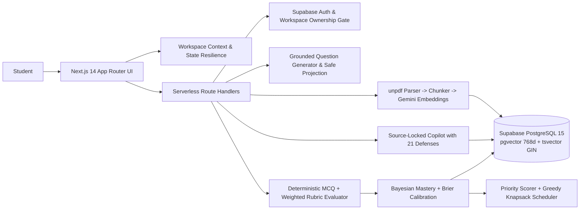

# GapLens AI — See the gaps. Master what matters.

GapLens AI is an autonomous, evidence-grounded study diagnostic platform. It builds an interactive syllabus knowledge map from course materials, generates citation-backed diagnostics with cheat-proof client projections, detects high-confidence blind spots, and translates results into an adaptive revision plan strictly bounded by the student's real daily study time.

> **Synthetic Demo Disclosure:** The bundled Operating Systems (CS-301) course is a complete, realistic sample dataset. In offline demo mode, all 6 screens function with client-side state resilience. Live remote Supabase and Gemini integrations are implemented and tested, but require provider credentials for remote production execution.

---

## The Problem and The GapLens Solution

Students preparing for high-stakes university and professional exams frequently revise all topics equally, unaware of their critical conceptual gaps. Conventional AI study tools passively wait for students to ask questions, often providing plausible hallucinations with unverified sources.

GapLens AI closes the loop through a 16-step proactive learning engine:
$$\text{Upload} \to \text{Extract} \to \text{Index} \to \text{Map} \to \text{Assess} \to \text{Diagnose} \to \text{Plan} \to \text{Revise} \to \text{Retest} \to \text{Update}$$

1. **Ingest Syllabus, Notes & Past Papers:** Presigned storage uploads handle up to 50MB PDFs directly without serverless memory bottlenecks.
2. **Build Topic Hierarchy & Prerequisite DAG:** Automatically maps lecture concepts and past-paper marks into a directed knowledge graph.
3. **Generate Grounded Diagnostics:** Synthesizes MCQs and rubric-weighted short answers strictly cited from source chunks.
4. **Decoupled Confidence Capture:** Records student confidence (`Low`, `Medium`, `High`) before revealing correctness to catch dangerous misconceptions.
5. **Diagnose Gaps & Metacognitive Calibration:** Bayesian mastery tracking ($\gamma = 0.80$) and Brier scores highlight high-confidence blind spots.
6. **Time-Budgeted Adaptive Scheduler:** Greedy knapsack packing strictly enforces the daily minute ceiling ($\sum d_i \le M_{\text{daily}}$).
7. **Retest & Adaptive Re-planning:** Retesting updates mastery history in `mastery_snapshots` and repacks pending tasks while preserving completed progress.

---

## 1-Click Judge Demo

Evaluators, hackathon judges, and engineering recruiters can explore the complete application in under 5 seconds:
1. Open the landing page (`/`) and click **"1-Click Judge Demo (OS CS-301)"**.
2. **Dashboard (`/dashboard`):** Inspect global exam readiness ($59.1\%$), assessed topic progress, and today's revision queue.
3. **Materials (`/materials`):** Explore uploaded course notes, ingestion states, and the interactive prerequisite topic graph.
4. **Diagnostic Lab (`/diagnostic`):** Take diagnostic challenges, rate confidence, and view citation excerpts in the side drawer.
5. **Gap Report (`/gap-report`):** Inspect the product centerpiece—the Mastery Matrix, Metacognitive Calibration Matrix, and expandable Evidence Ledger.
6. **Revision Planner (`/planner`):** Adjust daily study minutes, check off tasks, and consult the source-locked Study Copilot.

*Demo Identity:* `demo@gapfinder.ai` (Pre-seeded Operating Systems CS-301 workspace).

---

## Full-Stack Architecture



### Key Repository Directories

| Directory | Purpose | Key Modules |
|---|---|---|
| `src/app/` | 6 Product Screens & Next.js API Route Handlers | `(screens)/`, `api/upload/`, `api/quiz/`, `api/gap-report/` |
| `src/lib/rag/` | PDF Parsing, Heading-Aware Chunking, RRF Hybrid Search | `pdf-parser.ts`, `chunker.ts`, `hybrid-retrieval.ts`, `citation-verifier.ts` |
| `src/lib/algorithms/` | Cognitive Mastery, Calibration, Scheduling, Evaluation | `mastery.ts`, `blind-spots.ts`, `priority.ts`, `scheduler.ts`, `evaluator.ts` |
| `src/lib/supabase/` | Database Clients, Session Resolution, RLS Enforcement | `auth.ts`, `client.ts`, `server.ts`, `admin.ts` |
| `supabase/migrations/` | 13 Normalized Tables, RRF Stored Procedure, RLS Policies | `20261118000001_create_schema.sql` to `...000003_rls_and_storage.sql` |
| `tests/` | Automated Unit, Integration, and E2E Test Suites | 38 test files, 462 tests, Tiers 1-4 E2E coverage |

---

## Data Model & Row Level Security

The schema normalizes an initial 10-table proposal into **13 relational PostgreSQL tables**:
- `workspaces`: Tenant isolation boundary.
- `documents` & `document_chunks`: Ingestion metadata, `vector(768)` HNSW index, and `tsvector` GIN index.
- `topics`, `topic_prerequisites` (DAG edges), and `topic_materials`: Hierarchical knowledge graph.
- `quizzes`, `quiz_questions`, and `answers`: Assessment session records and student responses.
- `mastery_snapshots`: Append-only historical event ledger for longitudinal learning curves.
- `revision_plans` & `revision_tasks`: First-class relational task entities with daily order and chunk citations.
- `audit_logs`: Security and ingestion traces.

Kernel-level **Row Level Security (RLS)** is enabled on all tables in `supabase/migrations/20261118000003_rls_and_storage.sql`. The browser client uses strictly unprivileged anon keys; the elevated service-role key is isolated to `src/lib/supabase/admin.ts`.

---

## Core Algorithms & Invariants

1. **Reciprocal Rank Fusion (RRF):** Fuses dense vector similarity and sparse keyword search inside PostgreSQL:
   $$\text{RRF Score}(d) = \sum_{m \in \{\text{dense}, \text{sparse}\}} \frac{1}{60 + \text{rank}_m(d)}$$
2. **Two-Tier Citation Verification:** Attaches trusted DB metadata and validates that claimed quotes achieve $\ge 85\%$ normalized token Dice overlap against raw source chunks.
3. **Zero-Leak Client Projections:** Strips answer keys, rubrics, and explanations from diagnostic payloads before sending to the browser.
4. **Bayesian Mastery Update:** Exponential moving average with prior inertia $\gamma = 0.80$ and difficulty multiplier $k \in \{0.85, 1.0, 1.2\}$:
   $$\mu_t = 0.80 \cdot \mu_{t-1} + 0.20 \cdot \min(1.0, \text{score} \cdot k)$$
5. **Ebbinghaus Recency Decay:** Exponential forgetting decay with a 14-day memory half-life ($\lambda \approx 0.04951$).
6. **Multi-Factor Priority Scoring:** Combines mastery deficit ($40\%$), exam importance ($30\%$), blind-spot penalty ($20\%$), and prerequisite blocker depth ($10\%$) with dynamic weight renormalization.
7. **Greedy Knapsack Packing:** Partitions study tasks into daily blocks strictly bounded by $\sum \text{duration} \le M_{\text{daily}}$.
8. **Source-Locked Copilot:** 21 prompt-injection defenses and an exact canonical refusal string when evidence is insufficient.

---

## Technical Interview Preparation Hub

The repository includes a comprehensive 13-guide interview hub in [`docs/interview-prep/`](./docs/interview-prep/README.md) written specifically for technical recruiters, engineering hiring managers, and system design interviews:

| Guide # | File | Core Engineering Topic |
|:---:|---|---|
| **00** | [`00-START-HERE.md`](./docs/interview-prep/00-START-HERE.md) | Reading roadmap, system overview, 16-step canonical loop, elevator pitch |
| **01** | [`01-database-and-schema-architecture.md`](./docs/interview-prep/01-database-and-schema-architecture.md) | 13-table schema, pgvector HNSW 768d, tsvector GIN, RLS policies, RRF stored proc |
| **02** | [`02-rag-pipeline-and-chunking.md`](./docs/interview-prep/02-rag-pipeline-and-chunking.md) | Direct storage upload, unpdf parser, 500-800 token chunker, scanned PDF check ($<50$ chars) |
| **03** | [`03-hybrid-retrieval-and-rrf.md`](./docs/interview-prep/03-hybrid-retrieval-and-rrf.md) | Dense cosine + Sparse full-text search fusion via Reciprocal Rank Fusion ($k=60$) |
| **04** | [`04-citation-pinning-and-quote-verification.md`](./docs/interview-prep/04-citation-pinning-and-quote-verification.md) | Database metadata pinning, whitespace/punct normalization, $\ge 85\%$ token overlap |
| **05** | [`05-question-generation-and-evaluation.md`](./docs/interview-prep/05-question-generation-and-evaluation.md) | Grounded MCQs, rubric-grounded short answers, zero-knowledge client projections |
| **06** | [`06-bayesian-mastery-and-recency-decay.md`](./docs/interview-prep/06-bayesian-mastery-and-recency-decay.md) | Bayesian update ($\gamma=0.80, \mu_0=0.45, k=1.2$), Ebbinghaus forgetting decay |
| **07** | [`07-confidence-calibration-and-blind-spots.md`](./docs/interview-prep/07-confidence-calibration-and-blind-spots.md) | Decoupled confidence capture, high-confidence error detection ($<0.50$), Brier score |
| **08** | [`08-prioritized-revision-planning-and-budgeting.md`](./docs/interview-prep/08-prioritized-revision-planning-and-budgeting.md) | Multi-factor priority score, dynamic reweighting, greedy daily packing ($\sum \le M_{\text{daily}}$) |
| **09** | [`09-grounded-study-copilot-and-prompt-defense.md`](./docs/interview-prep/09-grounded-study-copilot-and-prompt-defense.md) | Source-locked copilot, 21 prompt-injection defenses, exact canonical refusal contract |
| **10** | [`10-full-stack-frontend-and-ui-architecture.md`](./docs/interview-prep/10-full-stack-frontend-and-ui-architecture.md) | Next.js 14 App Router, 6 core screens, client state context, dark midnight navy |
| **11** | [`11-security-rls-and-production-readiness.md`](./docs/interview-prep/11-security-rls-and-production-readiness.md) | Security architecture, server-only keys, RLS policies, error boundaries, deployment |
| **12** | [`12-glossary-and-quick-revision.md`](./docs/interview-prep/12-glossary-and-quick-revision.md) | 50+ technical terms, algorithmic formulas cheat sheet, interview flashcards, 60s pitch |

Every guide includes all 8 mandatory sections: Why Selected, What Problem It Solves, How Code Works, Data Flow ASCII diagram, Important Algorithms & Formulas, Technical Trade-offs, Testing Evidence, and Potential Interview Questions (Beginner-Friendly followed by Deep Technical Rigor).

---

## Local Development & Setup

### Prerequisites
- Node.js 18.17+ or Node.js 20+
- `pnpm` (v9+)
- (Optional) Supabase CLI & Google AI Studio API Key for live provider mode

### Quickstart
```bash
# 1. Clone repository
git clone https://github.com/your-username/GapLensAI.git
cd GapLensAI

# 2. Configure environment template
cp .env.example .env.local

# 3. Install dependencies
pnpm install

# 4. Start local development server
pnpm dev
```
Open `http://localhost:3000` to interact with the application.

### Canonical Verification Commands
```bash
pnpm test        # Unit and integration test suite (37 files, 453 tests passing)
pnpm test:e2e    # Structural E2E acceptance suite (18 files, 296 tests passing)
pnpm typecheck   # TypeScript strict type checking (tsc --noEmit)
pnpm lint        # ESLint validation (next lint)
pnpm build       # Next.js production build (20 static pages compiled)
```

---

## Production Deployment to Vercel

1. **Push to GitHub:** Push repository to your GitHub account.
2. **Import into Vercel:** Connect the repository in the Vercel Dashboard.
3. **Configure Environment Variables:** Add values from `.env.example`:
   - `NEXT_PUBLIC_SUPABASE_URL`
   - `NEXT_PUBLIC_SUPABASE_ANON_KEY`
   - `SUPABASE_SERVICE_ROLE_KEY` (Server-only; uncheck client exposure)
   - `GEMINI_API_KEY`
4. **Deploy:** Trigger deployment. The default build command (`pnpm build`) will compile cleanly.
5. **Database Initialization:** Run `supabase db push` to apply migrations in `supabase/migrations/`.
